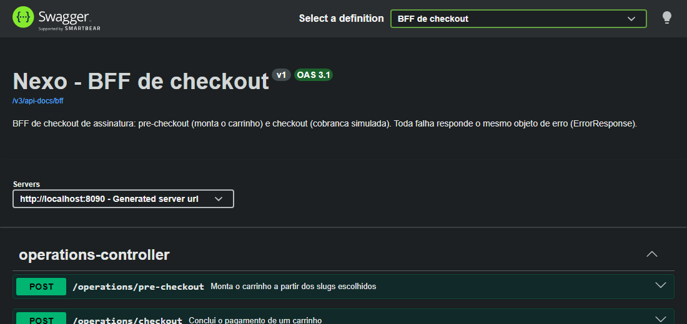
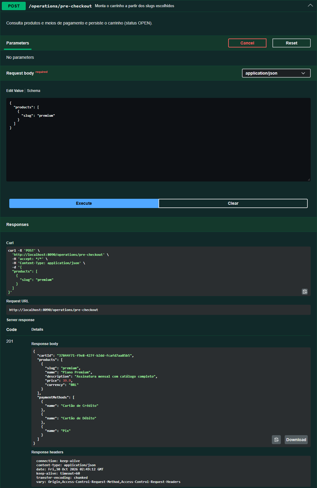
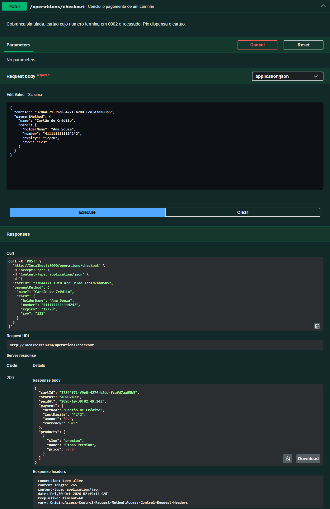
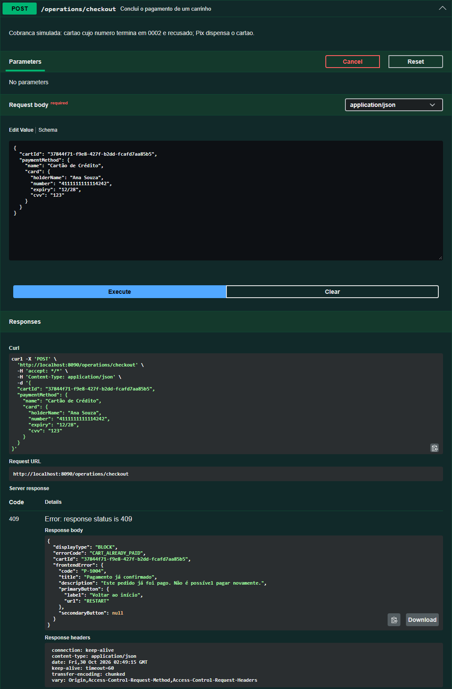
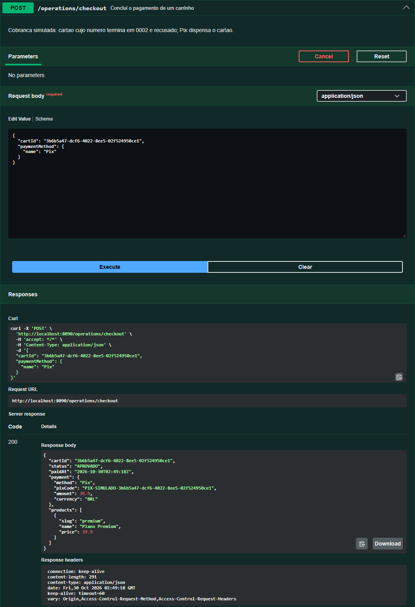
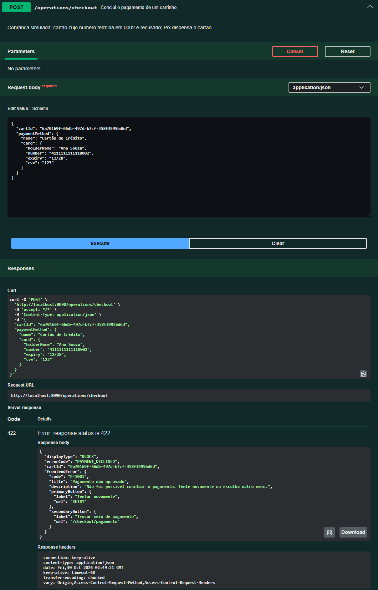
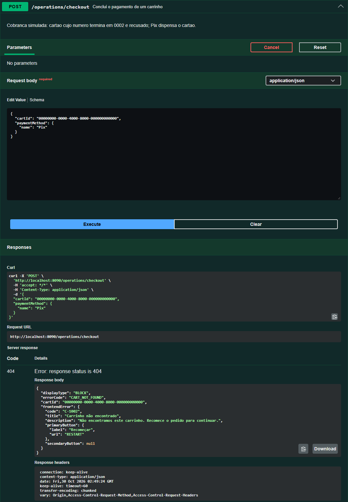
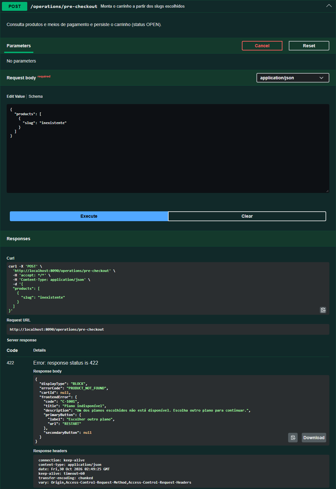

# Testando os fluxos do BFF pelo Swagger UI

Este passo a passo mostra como exercitar, só pelo navegador, os fluxos do BFF
de checkout: criar um carrinho, pagar com cartão, pagar com Pix, provocar uma
recusa e ver os erros mais comuns. Você não precisa de `curl`, Postman nem de
código: basta copiar os JSON deste documento para o Swagger UI.

## O que você vai testar

| # | Fluxo | Resultado esperado |
| --- | --- | --- |
| 1 | Pré-checkout e pagamento aprovado com cartão | `201`, depois `200 APROVADO` |
| 2 | Pagar de novo o mesmo carrinho | `409 CART_ALREADY_PAID` |
| 3 | Pagamento aprovado com Pix | `200 APROVADO` com `pixCode` |
| 4 | Cartão recusado e nova tentativa | `422 PAYMENT_DECLINED`, depois `200 APROVADO` |
| 5 | Erros de entrada | `404`, `422` e `400` |

A cobrança é simulada. O resultado depende só do meio de pagamento e do número
do cartão:

| Cartão | Resultado |
| --- | --- |
| Número que **não** termina em `0002` (por exemplo `4111111111114242`) | Aprovado |
| Número que **termina** em `0002` (por exemplo `4111111111110002`) | Recusado |
| Pix (sem cartão) | Sempre aprovado |

## 1. Suba a API

Com o Docker ativo, na pasta `nexo/`:

**PowerShell** (Windows, preferencial):

```powershell
Copy-Item .env.example .env
docker compose up --build -d --wait
```

**Linux e macOS**:

```bash
cp .env.example .env
docker compose up --build -d --wait
```

Quando o comando terminar, a API está em `http://localhost:8080`. Os detalhes,
as portas e a execução pelo IDE estão no [README](../README.md#início-rápido).

> **Sobre as capturas de tela:** elas foram feitas com a API em
> `http://localhost:8090`, porque a 8080 do computador usado estava ocupada. No
> seu ambiente, o endereço é `http://localhost:8080` (ou o valor de `APP_PORT`
> no `.env`). Fora isso, as telas são as mesmas.

## 2. Abra o Swagger UI

No navegador, acesse:

```text
http://localhost:8080/swagger-ui.html
```

O endereço redireciona para `/swagger-ui/index.html`. Na página, o seletor
**Select a definition** deve estar em **BFF de checkout**, e a lista mostra duas
operações:

- `POST /operations/pre-checkout`: monta o carrinho.
- `POST /operations/checkout`: conclui o pagamento.



## 3. Como executar uma operação

O procedimento é o mesmo em todos os fluxos:

1. Clique na linha da operação para expandi-la.
2. Clique em **Try it out**. O campo **Request body** passa a ser editável.
3. Apague o conteúdo do campo e cole o JSON do passo.
4. Clique em **Execute**.
5. Role até **Server response** e confira o **Code** e o **Response body**.

Duas observações valem para todos os passos:

- O Swagger UI reformata o JSON da resposta antes de exibi-lo, e por isso o
  preço aparece como `39.9`. A API responde `39.90`.
- O `cartId` muda a cada pré-checkout. Os valores de `cartId` das capturas
  são só ilustrativos: use sempre o da **sua** resposta.

## Fluxo 1: pagamento aprovado com cartão

### Passo 1.1: pré-checkout

Operação: `POST /operations/pre-checkout`.

```json
{
  "products": [
    { "slug": "premium" }
  ]
}
```

Resultado esperado: **`201`**. A resposta traz o `cartId`, o produto e os três
meios de pagamento. **Copie o valor de `cartId`.**



Você pode enviar mais de um plano. Os slugs válidos são `basico`, `premium` e
`familia`, e o total do carrinho é a soma dos preços.

### Passo 1.2: checkout com cartão

Operação: `POST /operations/checkout`. Troque `COLE-AQUI-O-CARTID` pelo
`cartId` copiado:

```json
{
  "cartId": "COLE-AQUI-O-CARTID",
  "paymentMethod": {
    "name": "Cartão de Crédito",
    "card": {
      "holderName": "Ana Souza",
      "number": "4111111111114242",
      "expiry": "12/28",
      "cvv": "123"
    }
  }
}
```

Resultado esperado: **`200`** com `"status": "APROVADO"`. A resposta traz só os
quatro últimos dígitos do cartão (`lastDigits`: `4242`). A API não devolve o
número completo, o CVV, o titular nem a validade.



> A validade (`expiry`) precisa estar no formato `MM/AA` e não pode estar
> vencida. Se o exemplo `12/28` já tiver vencido quando você testar, use uma
> data futura.

## Fluxo 2: pagamento duplicado

Com o Swagger UI ainda em `POST /operations/checkout`, clique em **Execute**
de novo, **sem mudar nada**: o mesmo carrinho já foi pago.

Resultado esperado: **`409`**, `errorCode` `CART_ALREADY_PAID`, com o botão
principal "Voltar ao início". A API não cobra uma segunda vez.



## Fluxo 3: pagamento aprovado com Pix

O Pix não leva cartão. Você precisa de um carrinho novo.

1. Em `POST /operations/pre-checkout`, execute o mesmo JSON do passo 1.1 e
   copie o novo `cartId`.
2. Em `POST /operations/checkout`, use este JSON:

```json
{
  "cartId": "COLE-AQUI-O-CARTID",
  "paymentMethod": {
    "name": "Pix"
  }
}
```

Resultado esperado: **`200`** com `"status": "APROVADO"`. No lugar de
`lastDigits`, a resposta traz `pixCode`.



## Fluxo 4: cartão recusado e nova tentativa

Qualquer cartão de crédito ou débito cujo número termine em `0002` é recusado.

### Passo 4.1: carrinho novo

Execute o pré-checkout do passo 1.1 outra vez e copie o `cartId`.

### Passo 4.2: checkout com o cartão recusado

```json
{
  "cartId": "COLE-AQUI-O-CARTID",
  "paymentMethod": {
    "name": "Cartão de Crédito",
    "card": {
      "holderName": "Ana Souza",
      "number": "4111111111110002",
      "expiry": "12/28",
      "cvv": "123"
    }
  }
}
```

Resultado esperado: **`422`**, `errorCode` `PAYMENT_DECLINED`, código `P-1001`.
A resposta traz dois botões: "Tentar novamente" (`RETRY`) e "Trocar meio de
pagamento" (`/checkout/pagamento`).



### Passo 4.3: nova tentativa no mesmo carrinho

A recusa **não bloqueia** o carrinho. Troque só o número do cartão para um que
não termine em `0002` e execute de novo, com o mesmo `cartId`:

```json
{
  "cartId": "COLE-AQUI-O-CARTID",
  "paymentMethod": {
    "name": "Cartão de Crédito",
    "card": {
      "holderName": "Ana Souza",
      "number": "4111111111114242",
      "expiry": "12/28",
      "cvv": "123"
    }
  }
}
```

Resultado esperado: **`200`**, `"status": "APROVADO"`.


## Fluxo 5: erros de entrada

Toda falha responde o mesmo objeto, com `displayType`, `errorCode`, `cartId` e
`frontendError`. O `cartId` e o `secondaryButton` valem `null` quando não se
aplicam.

### Carrinho inexistente (`404`)

Em `POST /operations/checkout`:

```json
{
  "cartId": "00000000-0000-4000-8000-000000000000",
  "paymentMethod": {
    "name": "Pix"
  }
}
```

Resultado esperado: **`404`**, `errorCode` `CART_NOT_FOUND`.



### Produto inexistente (`422`)

Em `POST /operations/pre-checkout`:

```json
{
  "products": [
    { "slug": "inexistente" }
  ]
}
```

Resultado esperado: **`422`**, `errorCode` `PRODUCT_NOT_FOUND`. Nenhum carrinho
é criado (`cartId` é `null`).



### Outros erros que você pode provocar

Estes três foram executados por `curl` contra a API, e não pelo Swagger UI, por
isso não têm captura de tela. Os JSON valem do mesmo jeito no Swagger UI.

| Como provocar | Operação | Resultado |
| --- | --- | --- |
| Repetir um slug: `{"products":[{"slug":"premium"},{"slug":"premium"}]}` | `pre-checkout` | `400 INVALID_REQUEST` |
| Cartão com `"cvv": "12"` (o CVV tem 3 ou 4 dígitos) | `checkout`, em carrinho aberto | `422 INVALID_PAYMENT_DATA` |
| Meio de pagamento `{"name": "Boleto"}` | `checkout`, em carrinho aberto | `422 PAYMENT_METHOD_NOT_ALLOWED` |

A tabela completa de erros, com os códigos e os botões, está no
[README](../README.md#tabela-de-erros).

## Extra: serviços externos simulados

A própria aplicação serve os "serviços externos" de produtos e de meios de
pagamento, e o BFF os consome por HTTP. Você pode consultá-los direto no
navegador:

- `http://localhost:8080/mock-services/products`
- `http://localhost:8080/mock-services/payment-methods`

Ambos respondem `200` com a lista em JSON. No Swagger UI, eles aparecem na
definição **Servicos externos simulados** (assim, sem acento, como o Swagger UI
a exibe), no seletor **Select a definition**. Essa tela não foi capturada.

## Extra: o cache do Redis

O catálogo de produtos e de meios de pagamento, que o **pré-checkout** consulta,
fica no Redis por 10 minutos. O objetivo é não chamar os dois serviços externos
a cada carrinho novo e manter o pré-checkout respondendo mesmo quando eles
oscilam. Só o `POST /operations/pre-checkout` usa o cache: o checkout cobra o
preço que o carrinho já guardou e não consulta nem o catálogo nem o Redis. O
Swagger UI não mostra o cache, mas dá para observá-lo no terminal. Os comandos
abaixo são iguais no PowerShell e no bash.

1. No Swagger UI, execute o pré-checkout do [fluxo 1](#fluxo-1-pagamento-aprovado-com-cartão).
2. No terminal, veja as duas entradas e o tempo de vida que resta (em segundos,
   perto de `600` logo depois de criada):

   ```powershell
   docker compose exec -T redis redis-cli --scan
   docker compose exec -T redis redis-cli ttl catalog-products::all
   ```

   ```text
   catalog-payment-methods::all
   catalog-products::all
   595
   ```

3. Execute o pré-checkout de novo no Swagger UI e repita o `ttl`. O número
   continua diminuindo em vez de voltar a `600`: a entrada não foi regravada, e o
   catálogo veio do cache.

Para saber onde o cache está no código, por que ele existe, como ele se comporta
com o Redis parado e quais testes o cobrem, veja [Cache](../README.md#cache) no
README. Os valores acima vêm de uma execução com a API no Docker.

## Problemas comuns

| Sintoma | Causa provável | O que fazer |
| --- | --- | --- |
| A página não abre em `localhost:8080` | A API não subiu, ou a 8080 está ocupada | Confira com `docker compose ps`. Se a 8080 estiver ocupada, defina `APP_PORT` no `.env` e use essa porta na URL. |
| `404 CART_NOT_FOUND` num `cartId` que você copiou | O `cartId` não existe neste banco (por exemplo, é de antes de um `docker compose down -v`) | Faça um novo pré-checkout e copie o `cartId` da resposta mais recente, sem aspas nem espaços. |
| `400 INVALID_REQUEST` | JSON malformado ou campo faltando | Cole o JSON inteiro do passo, incluindo as chaves de abertura e de fechamento. |
| `409 CART_ALREADY_PAID` num carrinho novo | O `cartId` é de um carrinho já pago | Faça um novo pré-checkout. |
| `503 SERVICE_UNAVAILABLE` | O serviço de produtos ou de meios de pagamento não respondeu | Veja o log do container `app`: `docker compose logs app`. |

Para encerrar e apagar também o banco de teste:

```bash
docker compose down -v
```
